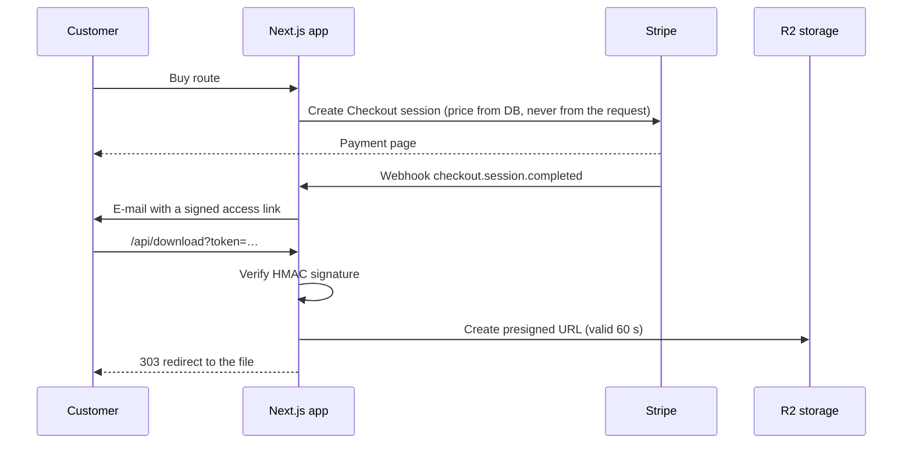

# SML Moto

Web shop for curated motorcycle routes across Alpine passes. Customers buy a
route and download GPX files for their navigation device — without creating
an account.

**Status:** deployed as a client preview at [sml.admtechnics.sk](https://sml.admtechnics.sk).
Public launch waits for the client's payment account. The site is in
Slovak, English, German and French.

> This repository is public, so the paid content is not in it. Only sample
> GPX files (`content/gpx/example-*`) are committed.

## Stack

Next.js 16 (App Router, Server Actions) · React 19 · TypeScript · Neon
(PostgreSQL) · Cloudflare R2 (S3-compatible storage) · Stripe Checkout ·
Leaflet · Zod · Vitest · Vercel

## How a purchase works



## Design decisions

**No customer accounts.** Access is a token signed with HMAC-SHA256
(`lib/signed-token.ts`). It is not stored anywhere and cannot be forged
without the secret. Comparison uses `timingSafeEqual`, so the signature
cannot be guessed byte by byte from response times.

**Tokens never expire.** Riders buy a route weeks before the trip and open
it repeatedly on the road. Expiry would only produce support requests.
Because old links live in customers' inboxes, the token format must never
change — a test guards it (`lib/signed-token.test.ts`).

**Files are private and served by redirect.** Route files live in a private
Cloudflare R2 bucket, never in `public/`. `/api/download` verifies the
token and redirects to a signed URL valid for one minute. Streaming the file
through the function would hit Vercel's 4.5 MB response limit.

**Database access goes through one data layer.** Only the server talks to
Postgres (Neon's HTTP driver — no connection pool to exhaust on serverless).
Public pages read through `getAllRoutes()`, which only returns published
routes; everything else either checks the admin session itself or takes a
route ID from a verified token, so a route withdrawn from sale stays
downloadable for people who bought it.

**Admin without a user table.** One admin, one password stored as a scrypt
hash, a signed session cookie for 12 hours. Login attempts are limited in the
database (5 per IP, 50 total per 15 minutes) because in-memory counters do
not work across serverless instances. Every page and Server Action checks the
session itself; the proxy in front of `/admin` is only a first filter.

**Replacing route files is ordered for safety.** New files are uploaded under
new names, then the database row is updated, and only then are the old files
deleted. If anything fails before the database write, customers keep getting
the old, complete package.

## Admin

`/admin` lets the client upload a route export (GPX, KML or CSV), preview the
parsed track, fill in texts in four languages, publish or withdraw the route
and edit it later. Large uploads go straight from the browser to Storage via
a signed upload URL, because a Server Action accepts only 1 MB.

## Running locally

```bash
npm install
cp .env.example .env.local   # fill in keys
npm run dev
npm test                     # 129 tests
```

Without keys the site still runs: routes are read from `data/routes.json`
and checkout answers 503 with a "payments not configured" message.

Full setup (database migrations, storage bucket, admin password) is described
in [`AGENTS.md`](AGENTS.md) (Slovak).

## Repository note

The repository root still contains the client's old static site
(`index.html`, `style.css`, media folders), served by GitHub Pages until the
new app goes live. It will be removed after launch.
